# Architecture

This document explains how quickjs-napi is built and why. It is meant for
contributors and for embedders who need to understand what happens behind the
Node-API calls. The API itself is described in the
[Node-API reference](node-api/README.md) and the
[embedding guide](embedding.md).

- [Goals and constraints](#goals-and-constraints)
- [Components](#components)
- [Host and env](#host-and-env)
- [Values and handle scopes](#values-and-handle-scopes)
- [Calling native functions](#calling-native-functions)
- [Errors and exceptions](#errors-and-exceptions)
- [Object lifetime](#object-lifetime)
- [The event loop](#the-event-loop)
- [Loading addons](#loading-addons)
- [Teardown](#teardown)
- [Captured builtins](#captured-builtins)
- [Design decisions](#design-decisions)

## Goals and constraints

quickjs-napi implements Node-API (version 10) on top of the
[QuickJS](https://bellard.org/quickjs/) engine, so that addons compiled for
Node.js load **unchanged**. Everything in the design follows from that goal:

1. **Binary compatibility.** An addon built by node-gyp, node-addon-api or
   napi-rs does not link against any quickjs-napi library: it resolves the
   `napi_*` (and `uv_*`) symbols from the running process, exactly as it does
   from `node`. The executable must therefore export the whole Node-API and
   libuv.
2. **Observable Node.js semantics.** The reference is Node.js **22.23.4**
   (`src/js_native_api_v8.cc`, `src/node_api.cc`). Status codes, pending
   exceptions, property order, error messages and finalizer timing follow it.
   Each difference is a documented deviation (see
   [compatibility.md](compatibility.md)).
3. **QuickJS as it is.** The engine is used through its public C API
   (`quickjs.h`); it is not patched. When QuickJS lacks something V8 has (weak
   callbacks, `new.target` in C functions, a class ID enum, DataView
   accessors), the library builds it from what QuickJS has.

The main difference between the two engines is the memory model: **V8 uses a
tracing GC**, so an object stays alive until a collection finds it unreachable.
**QuickJS uses reference counting** plus a cycle collector, so an object is
freed as soon as its last reference goes away. Much of the lifetime machinery
below exists to make reference counting look like a tracing GC to addons.

## Components

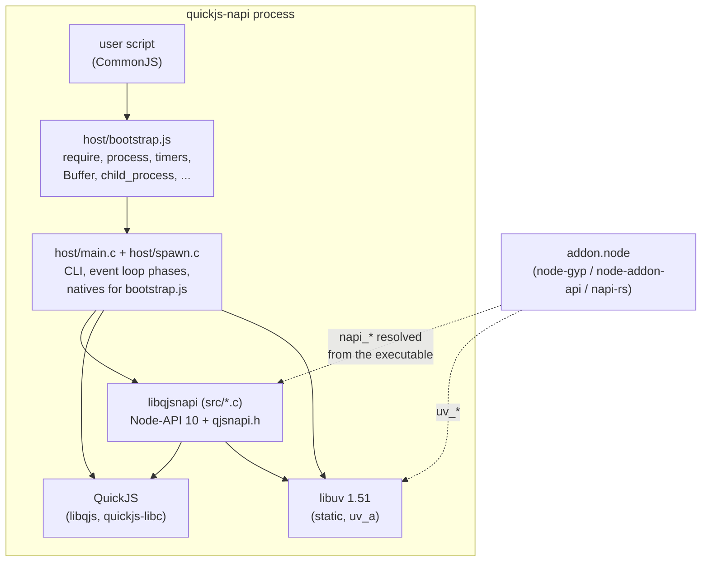

| Component | Role |
|---|---|
| `src/` (library `qjsnapi`) | The Node-API implementation and the embedding API `include/qjsnapi.h`. It does not depend on the executable and can be embedded in any QuickJS application. |
| `host/` (executable `quickjs-napi`) | A small Node.js-like runtime around the library: command line, CommonJS loader, `process`, timers, the event loop. It runs addons and the test suites. See [host.md](host.md). |
| QuickJS | Built as a subproject from `../quickjs-build`. `include/quickjs.h` must match it exactly (the `JSValue` ABI); configuration fails otherwise. |
| libuv | Fetched at configure time (v1.51.0), built statically and exported by the executable, because addons call `uv_*` directly. |

The library is linked into the executable as a **whole archive**
(`QJSNAPI_WHOLE_ARCHIVE` in `CMakeLists.txt`), so that the objects of
functions the host itself never calls are kept and exported too. The
`exports_complete` test (`tools/check_exports.py`) checks that all 155
functions are exported.

### Source layout of the library

| File | Responsibility | Node-API functions |
|---|---|---|
| `env.c` | host and env lifecycle, last error, cleanup hooks, versions, fatal errors | 9 |
| `scope.c` | handle-scope arena | 5 |
| `value.c` | singletons, numbers, booleans, `typeof`, coercion, arrays, strict equality | 24 |
| `string.c` | strings (latin1, UTF-8, UTF-16), property keys, symbols | 13 |
| `object.c` | properties, descriptors, key enumeration, prototype, freeze/seal, `instanceof` | 19 |
| `function.c` | functions, calls, `new.target`, classes, `napi_run_script` | 7 |
| `error.c` | error objects and exceptions | 12 |
| `lifetime.c` | references, externals, wrap, finalizers, type tags, instance data | 16 |
| `builtins.c` | ArrayBuffer, TypedArray, DataView, BigInt, Date, Promise | 25 |
| `buffer.c`, `buffer.js` | Node.js `Buffer` | 6 |
| `node_api.c` | async context, `napi_make_callback`, callback scopes, `napi_fatal_exception` | 6 |
| `async.c` | async work on the libuv thread pool | 4 |
| `tsfn.c` | thread-safe functions | 7 |
| `loop.c` | libuv loop ownership, finalizer handles, `napi_get_uv_event_loop` | 1 |
| `loader.c` | `.node` loading, legacy `napi_module_register` | 1 |
| `stubs_generated.c` | generated stubs for unimplemented functions (empty: everything is implemented) | 0 |

Shared types and helpers live in `src/qjsnapi_internal.h`. Internal functions
carry the `qn_` prefix and are hidden (`QN_INTERNAL`, ELF visibility
`hidden`), so the only exported symbols are the Node-API and `qjsnapi_*`
ones.

## Host and env

Node.js has one *environment* per thread and one `napi_env` per loaded addon.
quickjs-napi keeps the same split:

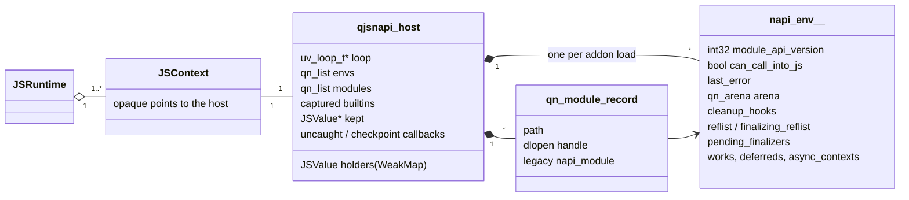

- **`qjsnapi_host`** (one per `JSContext`, stored as the context opaque) owns
  everything that is shared: the libuv loop, the captured builtins, the
  `WeakMap` of lifetime holders, the list of envs and loaded modules, the
  *kept objects* list, and the embedder's callbacks (uncaught exception
  handler, checkpoint).
- **`napi_env__`** (one per addon initialization) owns what Node.js keeps per
  module: the **module API version** (which changes some behaviours, e.g.
  `napi_cannot_run_js` instead of `napi_pending_exception` during teardown),
  the last error, the handle-scope arena, cleanup hooks, references, the
  finalizer queue, and the async objects not yet released.

Loading the same addon twice creates two envs, like `process.dlopen` in
Node.js: the initializer runs again and returns new exports.

## Values and handle scopes

A `napi_value` is an opaque pointer. In quickjs-napi it **points to a
`JSValue` slot** in an arena owned by the env. Each slot owns exactly one
QuickJS reference (`JS_DupValue` when the slot is filled, `JS_FreeValue` when
its scope closes). This is the reference-counting equivalent of a V8 local
handle.

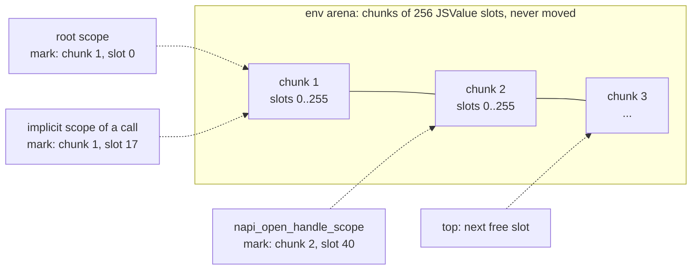

- Slots are allocated by bumping `arena.top`. Chunks are linked, never
  reallocated, so a `napi_value` stays valid until its scope closes.
- A scope records the arena position (`qn_mark`) when it opens. Closing it
  frees, in LIFO order, every slot allocated since then and resets `top`.
  Closing a scope is O(number of values created in it), with no per-handle
  bookkeeping.
- **Escapable scopes** reserve one slot in the parent *before* recording their
  own mark. `napi_escape_handle` stores a duplicated reference into that slot,
  so the value survives the inner scope. Escaping twice returns
  `napi_escape_called_twice`.
- Every native entry point (a function call, a finalizer, module init, a loop
  callback) runs inside an **implicit scope**, so addons that never open scopes
  do not leak. Closing a scope that is not the innermost one returns
  `napi_handle_scope_mismatch`.
- Scope records are recycled through a free list, so opening a scope does not
  allocate in the steady state.

## Calling native functions

`JS_NewCFunctionData` is not enough for Node-API: its trampoline does not expose
`new.target`, which `napi_get_new_target` and `napi_define_class` need. Native
functions are therefore objects of a dedicated QuickJS class with a `call`
hook. QuickJS passes `JS_CALL_FLAG_CONSTRUCTOR` and, for construct calls,
`new.target` as `this_val`.

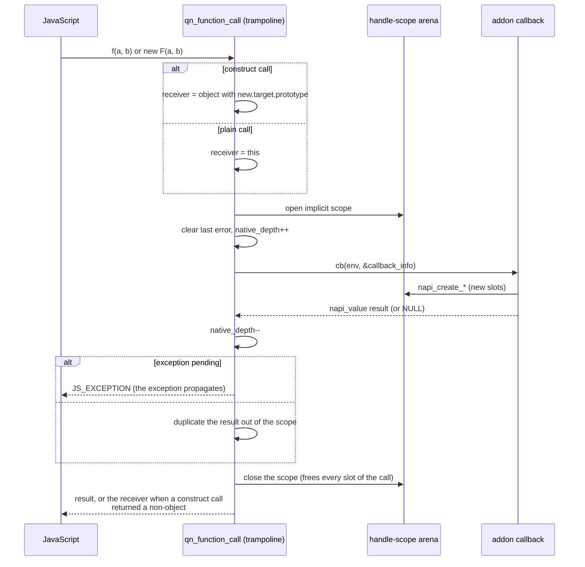

- `napi_callback_info` points to a stack record (`this`, `new.target`,
  `argc`, `argv`, `data`): there is no allocation per call.
- The per-function record (`qn_function`: env, callback, data) is owned by the
  function object and freed by its class finalizer. It holds no `JSValue`, so
  the class needs no `gc_mark` hook.
- `host->native_depth` counts the native frames on the stack. It is `0` only
  when no JavaScript is below the running native code, which is how callback
  scopes decide whether to run a microtask checkpoint.
- A function whose env is shutting down throws an `InternalError` instead of
  calling into the addon.

`napi_define_class` creates such a function and defines the instance
properties on its `prototype` and the static ones on the constructor. As with
V8's prototype templates, a later instance property with the same key replaces
an earlier one regardless of its attributes.

## Errors and exceptions

Node-API reports errors in two ways, and quickjs-napi keeps both exactly like
Node.js:

1. **Status codes.** Every function returns a `napi_status` and records it as
   the env's *last error* (`napi_get_last_error_info`). The checks are the
   macros of `qjsnapi_internal.h`, named after their Node.js equivalents:
   `CHECK_ENV`, `CHECK_ARG`, `RETURN_STATUS_IF_FALSE`, `NAPI_PREAMBLE`,
   `CHECK_JS`, `GET_RETURN_STATUS`.
2. **JavaScript exceptions.** QuickJS keeps the pending exception on the
   runtime. A JavaScript failure leaves it pending, exactly like V8, and the
   function returns `napi_pending_exception`.

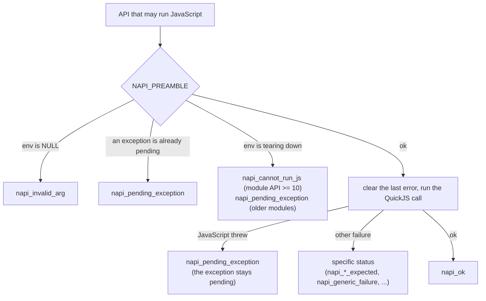

When a native callback returns with an exception pending, the trampoline
returns `JS_EXCEPTION`, so the exception propagates to the JavaScript caller.
When there is no JavaScript caller (a finalizer, an async work completion, a
thread-safe function call), the exception goes to the host's **uncaught
handler** (`qjsnapi_host_set_uncaught_handler`), which the executable maps to
`process.on('uncaughtException')`.

## Object lifetime

This is where the two engines differ most. The
[lifetime reference](node-api/lifetime.md) describes the API; this section
explains the mechanism.

### References

`napi_ref` (`struct napi_ref__`) mirrors `v8impl::Reference`:

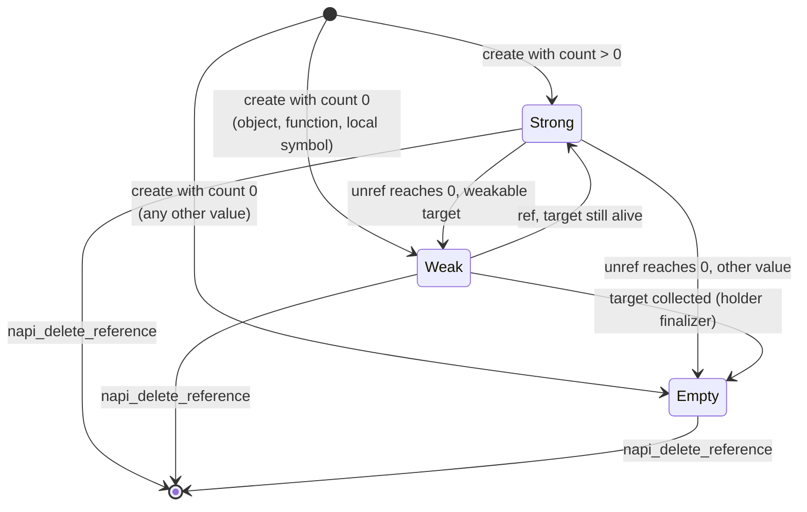

- **Strong** (count > 0): the reference owns a `JSValue`.
- **Weak** (count 0; object, function or non-registered symbol): it holds a
  JavaScript `WeakRef`. QuickJS reports a `WeakRef` target dead as soon as its
  refcount drops to zero, so `napi_get_reference_value` returns `NULL` exactly
  when the value is gone. The target is also on the *kept-objects* list until
  the next clear (see below).
- **Empty** (count 0, any other value): the value is released for good, like a
  reset V8 persistent.
- Registered symbols (`Symbol.for`) cannot be held weakly by QuickJS. They are
  never collected anyway, so they stay strong (`keep_strong`), which is what
  Node.js observably does.

### Kept objects

V8 keeps the target of a weak handle alive until the next GC. node-addon-api
relies on this: `Napi::Weak(Object::New(env))` is used later in the same
synchronous code. Under reference counting such an object would die when the
call's scope closes. So when a reference becomes weak, its target is also put
on a **kept-objects list**, like the `[[KeptAlive]]` list of ECMAScript
`WeakRef`s. The list is cleared:

- at the end of every macrotask (the library's checkpoint, after each callback
  from the event loop);
- by `gc()` in the executable;
- by the embedder, with `qjsnapi_host_clear_kept_objects`;
- at teardown.

### Weak callbacks through holders

V8 notifies a weak persistent when its target is collected; QuickJS has no
such hook in its C API. quickjs-napi gets the notification through a
**holder**:

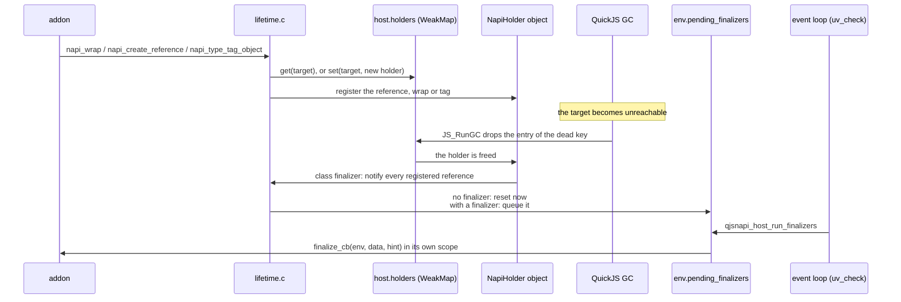

- Each target of a reference, wrap or type tag gets **one holder**, an object
  of the internal `NapiHolder` class stored in `host->holders`, a `WeakMap`
  keyed by the target.
- QuickJS drops the entries of dead keys during `JS_RunGC`. The holder is
  freed, and its class finalizer plays the role of V8's weak callback.
- The holder also stores the `napi_wrap` reference and the type tag, so
  **wrapping and tagging work on any object** (frozen objects, proxies,
  functions) without adding properties to it.
- QuickJS drops weak entries *before* collecting cycles, so a target that died
  in a cycle is only seen dead by a second pass: `gc()` runs `JS_RunGC` twice.

### Finalizers are deferred

Finalizers **never run inside the GC**. As in Node.js, they are queued on the
env (`pending_finalizers`) and run later from the event loop, where
JavaScript may run (`qjsnapi_host_run_finalizers`), each in its own handle
scope and followed by a checkpoint. Finalizers still queued at teardown run
then, with JavaScript disabled (`napi_cannot_run_js`).

External values (`napi_create_external`), external ArrayBuffers and external
Buffers use the same queue: their finalizer runs after the object is
collected, never synchronously.

## The event loop

The host is bound to a **libuv loop**: `qjsnapi_host_create` creates its own,
`qjsnapi_host_create_with_loop` uses the embedder's. The library only adds
handles to the loop; **the embedder runs it** (`uv_run`).

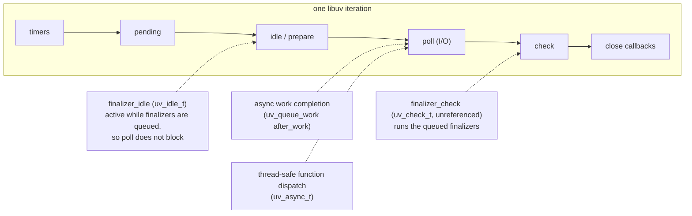

| Handle | Owner | Purpose |
|---|---|---|
| `finalizer_check` (`uv_check_t`, unreferenced) | `loop.c` | runs the queued finalizers at the end of each iteration, then a checkpoint |
| `finalizer_idle` (`uv_idle_t`) | `loop.c` | active only while finalizers are queued: keeps the loop alive and stops the poll phase from blocking (Node.js uses a referenced `SetImmediate`) |
| `uv_work_t` per queued work item | `async.c` | `execute` on the thread pool, `complete` on the loop thread |
| `uv_async_t` per thread-safe function | `tsfn.c` | wakes the loop thread to dispatch queued calls (referenced unless `napi_unref_threadsafe_function`) |

Every callback from the loop into native code goes through a **callback
frame** (`qn_callback_enter` / `qn_callback_leave`): a handle scope, a callback
scope, and on exit an exception check (reported as uncaught) and, for the
outermost scope, a **checkpoint**. The default checkpoint runs the pending
promise jobs (`JS_ExecutePendingJob`); the embedder can replace it
(`qjsnapi_host_set_checkpoint`) to drain its own queues too, which is what the
executable does for `process.nextTick` and unhandled rejections.

### Async work

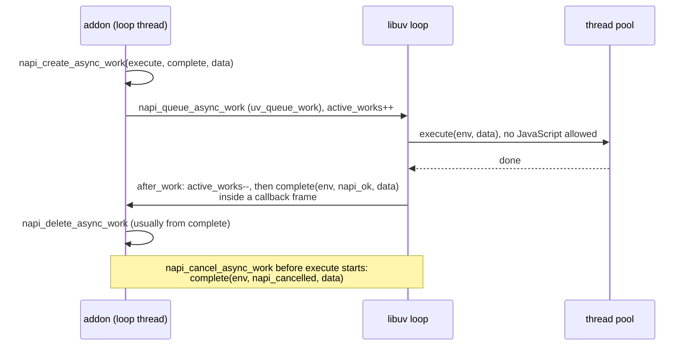

The item is uncounted *before* `complete` runs, so `complete` may queue the
same item again.

### Thread-safe functions

A port of Node 22's `v8impl::ThreadSafeFunction` on libuv primitives: a mutex,
a queue (bounded when `max_queue_size > 0`, with a condition variable for
blocked producers), a `uv_async_t` that wakes the loop thread, and at most
1000 calls dispatched per wake-up so that other handles are not starved.

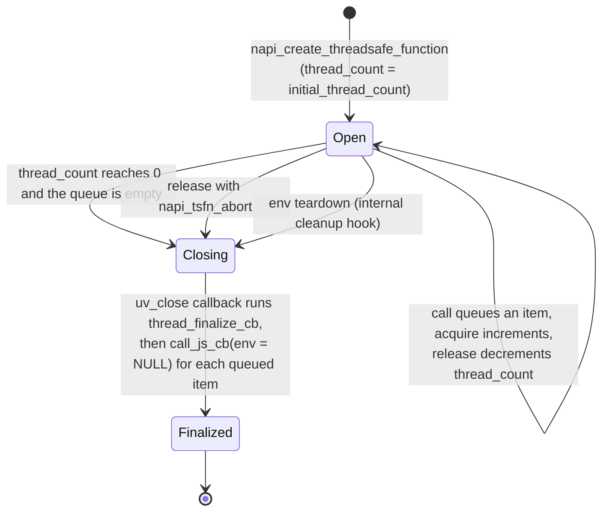

While closing, producers get `napi_closing`.

## Loading addons

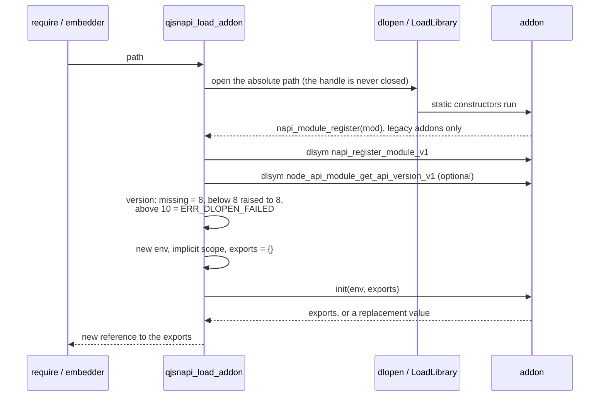

1. `node_api_module_get_api_version_v1` (optional, default 8) gives the module
   API version. A version above 10 is refused with `ERR_DLOPEN_FAILED`; one
   below 8 is raised to 8, as in Node.js.
2. `napi_register_module_v1` is the symbol-based entry point (what
   `NAPI_MODULE` and `NAPI_MODULE_INIT` produce).
3. Otherwise, a `napi_module` registered by `napi_module_register()` from a
   static constructor **during** `dlopen` (legacy addons). The constructor only
   runs on the first `dlopen` of a file, so the record is remembered and reused
   by later loads.

If the initializer returns a value other than `exports`, that value replaces
the exports, as Node.js assigns it to `module.exports`.

Library handles are **never closed**: finalizers and cleanup hooks may point
into addon code until the very end of the process.

Static addons, linked into the embedder, use `qjsnapi_init_static_addon`,
which runs the initializer once and caches its exports by name.

## Teardown

`qjsnapi_host_destroy` mirrors Node's `Environment::RunCleanup` and
`node_napi_env__::DeleteMe`:

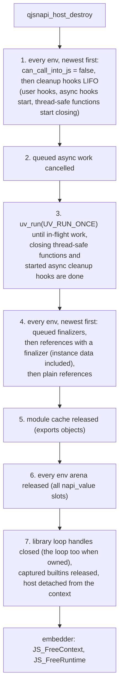

- References with a finalizer are finalized before plain ones, because their
  finalizers may delete plain references.
- Async work items and user references the addon never deleted are freed with
  the env. Node.js leaks them; here nothing can reach them after teardown, and
  freeing them keeps the QuickJS leak assertion (`JS_FreeRuntime` in Debug
  builds) meaningful.
- In the executable, `process.exit()` and fatal exceptions **skip** this
  teardown, as Node.js does: no cleanup hook or finalizer runs.

## Captured builtins

Some APIs have no QuickJS C equivalent and are implemented by calling a
JavaScript builtin: `WeakRef`, `WeakMap.prototype.get/set`, `Object.freeze`,
`Object.seal`, `Symbol`, `Symbol.for`, the `DataView` and `%TypedArray%`
getters, `Date.prototype.getTime`, and BigInt conversion to and from
hexadecimal. These are captured **when the host is created, before any user
script runs**, and stored on the host. Monkey-patching the globals later
therefore cannot change what Node-API reports, which matches V8, where these
operations do not go through JavaScript.

QuickJS does not export its class ID enum. The class IDs of `ArrayBuffer`,
`SharedArrayBuffer`, `DataView`, `Date` and the 12 typed arrays are found by
**probing one instance of each** at startup (`host->cid_*`); type checks then
compare class IDs.

## Design decisions

| Decision | Alternative | Why |
|---|---|---|
| Addons resolve `napi_*` from the executable | ship a `libnode`-like shared library | It is how addons are built for Node.js. Prebuilt binaries work unchanged, including MSVC builds on Windows (node-gyp's delay-load hook redirects the `node.exe` imports to the running process). |
| `napi_value` = pointer to an arena slot that owns one reference | box every value in a malloc'ed handle; or cast the `JSValue` itself | A `JSValue` is larger than a pointer on every target (a 16-byte struct on 64-bit, a NaN-boxed 64-bit value on 32-bit). The arena gives stable addresses, O(1) allocation, and scope release without per-handle bookkeeping. |
| Weak callbacks through a `WeakMap` of holders | patch QuickJS to add weak callbacks; add hidden properties to the target | Uses only the public API; works on frozen objects, proxies and functions; the engine stays unpatched. |
| Kept-objects list for weak targets | pure reference-counting semantics | Without it, objects referenced only weakly die when the creating call returns, which breaks node-addon-api (`Napi::Weak`). The list reproduces V8's "alive until the next GC" the same way ECMAScript `WeakRef` does. |
| Finalizers queued and run from the loop | run them in the QuickJS class finalizer | Node.js does the same; a QuickJS class finalizer runs inside the GC, where calling into the engine is unsafe. |
| Dedicated function class with a `call` hook | `JS_NewCFunctionData` | Only the `call` hook receives `new.target`, needed by `napi_get_new_target` and `napi_define_class`. |
| Builtins captured at startup | look them up on `globalThis` at each call | Immune to monkey-patching, like V8; no lookup per call. |
| libuv as the event loop | a custom loop | Addons call `napi_get_uv_event_loop` and `uv_*` directly; the semantics of async work and thread-safe functions are defined in libuv terms. |
| Library and executable are separate | a single executable | The library can be embedded in any QuickJS application ([embedding.md](embedding.md)); the executable is one embedder among others. |
| Free what the addon leaked at teardown | leak like Node.js | Debug builds of QuickJS assert that every object is released at `JS_FreeRuntime`, which turns any leak in the library into a test failure. |
| Node.js 22 as the behavioural reference, checked by running the same JS tests under Node.js | follow the Node-API documentation only | The documentation leaves many details open (property order, error codes, edge cases); the Node.js implementation and its test suites are the contract addons actually depend on. |
