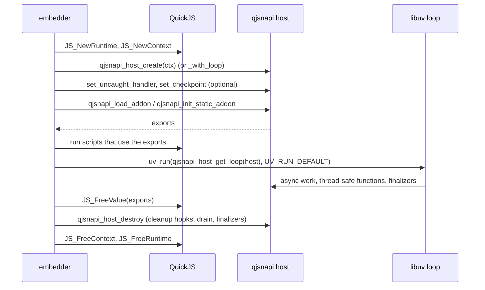

# Embedding API (`qjsnapi.h`)

The library `qjsnapi` can be embedded in any application that uses QuickJS.
`include/qjsnapi.h` is its whole public interface besides Node-API itself.
The `quickjs-napi` executable ([host.md](host.md)) is one such embedder, and
`test/unit/test_embed.c` is a complete, tested example.

- [Lifecycle at a glance](#lifecycle-at-a-glance)
- [Minimal embedder](#minimal-embedder)
- [Function reference](#function-reference)
- [Embedder responsibilities](#embedder-responsibilities)
- [Linking](#linking)

## Lifecycle at a glance



The rules are:

- **One host per `JSContext`.** The host is stored as the context opaque
  (`JS_SetContextOpaque`), so the embedder must not use that slot for anything
  else. `qjsnapi_host_from_context` gets it back.
- **One thread.** The context and the loop run on the same thread. Other
  threads only reach the host through thread-safe functions and async work.
- **Destroy before `JS_FreeContext`.** `qjsnapi_host_destroy` still needs the
  context to finalize references.

## Minimal embedder

```c
#include <stdio.h>
#include <uv.h>

#include "qjsnapi.h"
#include "quickjs.h"

static void on_uncaught(qjsnapi_host *host, JSContext *ctx, JSValue exc,
                        void *opaque) {
  (void)host;
  (void)opaque;
  const char *s = JS_ToCString(ctx, exc);
  fprintf(stderr, "uncaught: %s\n", s ? s : "?");
  JS_FreeCString(ctx, s);
  JS_FreeValue(ctx, exc); /* the handler owns the exception */
}

int main(void) {
  JSRuntime *rt = JS_NewRuntime();
  JSContext *ctx = JS_NewContext(rt);
  qjsnapi_host *host = qjsnapi_host_create(ctx);
  if (!host) return 1;
  qjsnapi_host_set_uncaught_handler(host, on_uncaught, NULL);

  JSValue exports;
  if (qjsnapi_load_addon(host, "./build/Release/addon.node", &exports) < 0) {
    JSValue exc = JS_GetException(ctx); /* the load error is pending */
    on_uncaught(host, ctx, exc, NULL);
  } else {
    JSValue global = JS_GetGlobalObject(ctx);
    JS_SetPropertyStr(ctx, global, "addon", exports); /* takes ownership */
    JS_FreeValue(ctx, global);

    JSValue r = JS_Eval(ctx, "addon.hello()", 13, "<main>",
                        JS_EVAL_TYPE_GLOBAL);
    if (JS_IsException(r)) on_uncaught(host, ctx, JS_GetException(ctx), NULL);
    JS_FreeValue(ctx, r);
  }

  /* Async work, thread-safe functions and finalizers run from the loop. */
  uv_run(qjsnapi_host_get_loop(host), UV_RUN_DEFAULT);

  qjsnapi_host_destroy(host);
  JS_FreeContext(ctx);
  JS_FreeRuntime(rt);
  return 0;
}
```

An addon linked into the application instead of loaded from a file:

```c
static napi_value Init(napi_env env, napi_value exports) {
  /* ... napi_define_properties(env, exports, ...) ... */
  return exports;
}

JSValue exports;
if (qjsnapi_init_static_addon(host, "my-static-addon", Init,
                              10 /* module API version */, &exports) < 0) {
  /* exception pending on ctx */
}
```

## Function reference

### Host lifecycle

#### `qjsnapi_host_create`

```c
qjsnapi_host *qjsnapi_host_create(JSContext *ctx);
```

Creates the Node-API host for `ctx`, with a **libuv loop of its own** that
`qjsnapi_host_destroy` closes. It captures the builtins Node-API needs,
evaluates the embedded `Buffer` class, probes the builtin class IDs and
registers the library's loop handles. Must be called before any user script
runs (see [captured builtins](architecture.md#captured-builtins)).
Returns `NULL` on failure; a JavaScript exception may then be pending.

#### `qjsnapi_host_create_with_loop`

```c
qjsnapi_host *qjsnapi_host_create_with_loop(JSContext *ctx,
                                            struct uv_loop_s *loop);
```

Same, on the embedder's loop. The loop must outlive the host and run on the
thread that owns `ctx`. The host adds its handles to it and removes them in
`qjsnapi_host_destroy`, but does not close the loop.

#### `qjsnapi_host_get_loop`

```c
struct uv_loop_s *qjsnapi_host_get_loop(qjsnapi_host *host);
```

The loop of the host: the one `napi_get_uv_event_loop` returns to addons and
the one the embedder must run.

#### `qjsnapi_host_from_context`

```c
qjsnapi_host *qjsnapi_host_from_context(JSContext *ctx);
```

The host attached to `ctx`, or `NULL`. Useful in native functions of the
embedder that only receive a `JSContext`.

#### `qjsnapi_host_destroy`

```c
void qjsnapi_host_destroy(qjsnapi_host *host);
```

Tears down every env as Node.js does at exit, with JavaScript disabled:

1. cleanup hooks, newest first (thread-safe functions start closing, async
   cleanup hooks start);
2. queued async work cancelled;
3. the loop runs until in-flight work, thread-safe functions and async cleanup
   hooks are done;
4. references and instance data finalized;
5. the module cache released and the host detached from the context.

The embedder closes its own handles on the loop first. Must be called before
`JS_FreeContext()`. The full order is described in
[architecture.md](architecture.md#teardown).

### Loading addons

#### `qjsnapi_load_addon`

```c
int qjsnapi_load_addon(qjsnapi_host *host, const char *path, JSValue *exports);
```

Loads a `.node` shared library and runs its Node-API initializer.

- Returns `0` and stores a **new reference** to the exports in `*exports`; the
  caller frees it.
- Returns `-1` with a JavaScript exception pending on the context. Its `code`
  property is `MODULE_NOT_FOUND` (the path cannot be resolved) or
  `ERR_DLOPEN_FAILED` (the library cannot be opened, does not register a
  module, or needs a Node-API version above 10). A legacy module registered
  without an init function fails with `Module has no declared entry point.`
  and no code, as in Node.js. An exception thrown by the initializer is left
  pending as it is.
- Like `process.dlopen`, **every call runs the initializer again** with a new
  env and returns new exports. Caching by path is the module loader's job.
- Fails while the host is being destroyed.

The entry point is resolved as described in
[architecture.md](architecture.md#loading-addons).

#### `qjsnapi_init_static_addon`

```c
int qjsnapi_init_static_addon(qjsnapi_host *host, const char *name,
                              napi_addon_register_func init,
                              int32_t module_api_version, JSValue *exports);
```

Runs the initializer of an addon **linked statically** into the embedder, as
if it had been loaded from `name`. `module_api_version` follows the
`node_api_module_get_api_version_v1` rules: `0` selects the default (8), a
value above 10 fails. Unlike `qjsnapi_load_addon`, the exports are **cached by
name**: a second call with the same name returns a new reference to the same
exports object without running `init` again. `node_api_get_module_file_name`
reports `name` for such an addon.

### Buffer and versions

#### `qjsnapi_host_get_buffer`

```c
JSValue qjsnapi_host_get_buffer(qjsnapi_host *host);
```

The minimal Node.js `Buffer` constructor used by `napi_create_buffer*`
(`Buffer.from`, `alloc`, `toString`, ...; see
[buffers](node-api/node-specific.md#buffers)). The library **does not install it
as a global**: the embedder decides where it is visible (the executable sets
`globalThis.Buffer` and `require('buffer')`). Returns a new reference.

#### `qjsnapi_node_version`

```c
const napi_node_version *qjsnapi_node_version(void);
```

What `napi_get_node_version` reports: `22.23.4`, the Node.js release whose
Node-API behaviour is reproduced, with release name `"quickjs-napi"`. A host
that provides `process` should report the same in `process.version`.

#### `qjsnapi_napi_version`

```c
uint32_t qjsnapi_napi_version(void);
```

The highest Node-API version supported by this build (`10`), the value of
`napi_get_version`.

### Finalizers and weak references

#### `qjsnapi_host_run_finalizers`

```c
size_t qjsnapi_host_run_finalizers(qjsnapi_host *host);
```

Runs the queued finalizers of every env (objects collected by the GC that
have a `napi_wrap`, `napi_add_finalizer`, external value, external
ArrayBuffer or external Buffer finalizer) and returns how many ran. The
library's `uv_check` handle already calls it once per loop iteration, so an
embedder that runs the host's loop does not need to; an embedder with its own
scheduling calls it outside of any JavaScript call. Finalizers still queued at
`qjsnapi_host_destroy` run then, with JavaScript disabled.

#### `qjsnapi_host_has_pending_finalizers`

```c
int qjsnapi_host_has_pending_finalizers(qjsnapi_host *host);
```

Non-zero while finalizers are queued: an event loop that decides itself when
to stop must not exit yet.

#### `qjsnapi_host_clear_kept_objects`

```c
void qjsnapi_host_clear_kept_objects(qjsnapi_host *host);
```

Releases the *kept objects*: the targets of references that became weak,
held strongly until now to reproduce V8's "alive until the next GC" (see
[architecture.md](architecture.md#kept-objects)). The library clears the list
at each of its own checkpoints. The embedder calls it **at the end of each
macrotask it runs itself** (a timer, an I/O callback) and **before an
explicit garbage collection** (`JS_RunGC`), otherwise weakly referenced
objects are collected later than expected.

### Callbacks of the embedder

#### `qjsnapi_host_set_uncaught_handler`

```c
typedef void (*qjsnapi_uncaught_fn)(qjsnapi_host *host, JSContext *ctx,
                                    JSValue exception, void *opaque);
void qjsnapi_host_set_uncaught_handler(qjsnapi_host *host,
                                       qjsnapi_uncaught_fn fn, void *opaque);
```

Called with an exception that no JavaScript frame can catch: thrown by a
finalizer, an async work `complete` callback, a thread-safe function's
`call_js_cb`, a promise job run by the default checkpoint, or passed to
`napi_fatal_exception`. Node.js emits `process.on('uncaughtException')` or
exits. **The handler takes ownership of `exception`.** Without a handler, and
always during `qjsnapi_host_destroy`, the exception is printed on stderr
(`quickjs-napi: uncaught exception in a Node-API callback: ...`) and dropped.

#### `qjsnapi_host_set_checkpoint`

```c
typedef void (*qjsnapi_checkpoint_fn)(qjsnapi_host *host, JSContext *ctx,
                                      void *opaque);
void qjsnapi_host_set_checkpoint(qjsnapi_host *host, qjsnapi_checkpoint_fn fn,
                                 void *opaque);
```

Called after native code entered from the loop (async work completion,
thread-safe function calls, finalizers) and when the outermost callback scope
closes with no JavaScript below it: where Node.js runs its tick and microtask
queues and reports unhandled rejections. The default runs the pending promise
jobs (`JS_ExecutePendingJob`) and reports their exceptions to the uncaught
handler. An embedder with a `process.nextTick` queue or rejection tracking
installs its own (the executable does: `host_checkpoint` in `host/main.c`).

#### `qjsnapi_host_set_force_uncaught_exceptions_policy`

```c
void qjsnapi_host_set_force_uncaught_exceptions_policy(qjsnapi_host *host,
                                                       int force);
```

Node's `--force-node-api-uncaught-exceptions-policy` (default off). When off,
an exception thrown by a thread-safe function callback of an addon built for
Node-API < 10 becomes a `DEP0168` deprecation warning instead of an uncaught
exception. When on, it is always an uncaught exception.

## Embedder responsibilities

| Responsibility | How |
|---|---|
| Run the loop | `uv_run(qjsnapi_host_get_loop(host), ...)`; it runs async work completions, thread-safe function calls and queued finalizers. |
| Report uncaught exceptions | `qjsnapi_host_set_uncaught_handler`. |
| Drain the embedder's own queues | `qjsnapi_host_set_checkpoint` (microtasks, `nextTick`, unhandled rejections). |
| End macrotasks | `qjsnapi_host_clear_kept_objects` after each macrotask it runs itself, and before `JS_RunGC`. |
| Expose `Buffer` | `qjsnapi_host_get_buffer`, if scripts should see it. |
| Cache modules | `qjsnapi_load_addon` never caches; `require` does. |
| Tear down in order | close the embedder's handles, `qjsnapi_host_destroy`, then `JS_FreeContext`, `JS_FreeRuntime`. |
| Export the symbols | addons resolve `napi_*` and `uv_*` from the process (see below). |

## Linking

Addons do not link against the library: they find `napi_*` and `uv_*` in the
process. The executable that embeds the library must therefore **export**
them:

| Platform | What is needed |
|---|---|
| Linux, BSD | link the library as a whole archive and export dynamic symbols (`--export-dynamic`, CMake `ENABLE_EXPORTS`). |
| macOS | whole archive (`-force_load`); addons are linked with `-undefined dynamic_lookup`. |
| Windows (MinGW) | whole archive; the definitions carry `__declspec(dllexport)` (`NAPI_EXTERN`; libuv is built with `BUILDING_UV_SHARED`). node-gyp addons import from `node.exe` and are redirected to the running process by node-gyp's delay-load hook. |

`CMakeLists.txt` does all of this for the `quickjs-napi` target; an embedder
can copy that setup. `tools/check_exports.py <executable>` verifies that every
Node-API function is exported.

Link with `uv_a` (libuv) and the QuickJS library the headers in `include/`
were taken from.

### From a release package

The [release packages](building.md#release-packages) install a CMake
package:

```cmake
find_package(qjsnapi CONFIG REQUIRED)   # CMAKE_PREFIX_PATH=<package dir>
target_link_libraries(my_app PRIVATE qjsnapi::static)   # or qjsnapi::shared
```

| Target | What it is |
|---|---|
| `qjsnapi::static` | `libqjsnapi.a` + the bundled `libqjs.a` and `libuv.a`, with their system libraries |
| `qjsnapi::core` | `libqjsnapi.a` alone, to link **your own** QuickJS and libuv |
| `qjsnapi::quickjs`, `qjsnapi::uv` | the bundled `libqjs.a` and `libuv.a` |
| `qjsnapi::shared` | the shared library (`libqjsnapi.so`, `libqjsnapi.dylib`, `qjsnapi.dll`) |
| `qjsnapi::addon` | usage requirements of a `.node` addon for the `quickjs-napi` executable |
| `qjsnapi::quickjs-napi` | the executable |

`test/package/CMakeLists.txt` uses each of them; it is what the release
workflow runs on every package.

**Static: three archives.** QuickJS and libuv are separate archives so that
an embedder can replace them (`qjsnapi::core` plus its own libraries). The
replacements must be ABI-compatible with the headers of the package: the same
QuickJS release (`quickjs.h` defines the layout of `JSValue`) and a libuv 1.x
not older than the bundled one (`BUILDINFO.txt` has both versions). The rules
of the table above still apply: to load addons, the executable must link
`libqjsnapi.a` and libuv as whole archives and export their symbols.

**Shared.** The shared library contains QuickJS and libuv and exports
`napi_*`, `uv_*`, `qjsnapi_*` and the QuickJS API (`JS_*`, `js_*`). Create the
`JSRuntime` and `JSContext` with the QuickJS **of the library**: do not link
another QuickJS in the same process (two copies do not share class IDs and
atoms, and values cannot cross between them). Limits:

- **Windows:** node-gyp addons import Node-API from `node.exe`, and their
  delay-load hook redirects that to the *executable* of the process, not to
  `qjsnapi.dll`: they cannot load in a program that uses the DLL. Use the
  static archives (exporting the symbols from the executable, as above), or
  `quickjs-napi.exe`. Addons linked against `libqjsnapi.dll.a` instead load
  normally.
- **Linux, BSD, macOS:** addons find the symbols in the shared library, which
  is loaded globally with the executable; nothing else is needed.
