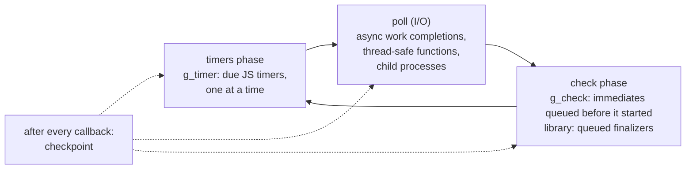

# The `quickjs-napi` executable

`quickjs-napi` is a small Node.js-like runtime built on the library. It runs
CommonJS scripts, loads `.node` addons with `require`, and provides the subset
of Node.js that addon packages and their tests need. It is also the reference
embedder of the library ([embedding.md](embedding.md)).

Sources: `host/main.c` (command line, event loop, natives),
`host/bootstrap.js` (module loader, `process`, builtin modules; embedded in
the executable at build time by `cmake/embed.cmake`) and `host/spawn.c`
(child processes).

- [Command line](#command-line)
- [Modules](#modules)
- [Globals](#globals)
- [Builtin modules](#builtin-modules)
- [Event loop](#event-loop)
- [Errors and exit](#errors-and-exit)
- [Not supported](#not-supported)

## Command line

```sh
quickjs-napi [options] script.js [args...]
quickjs-napi [options] -e <code> [args...]
```

| Option | Effect |
|---|---|
| `-e`, `--eval <code>` | run `code` instead of a script; `process.argv` is `[execPath, args...]` |
| `-r`, `--require <module>` | load the module before the script; repeatable |
| `--force-node-api-uncaught-exceptions-policy[=true\|false]` | report exceptions from thread-safe function callbacks of Node-API < 10 addons as uncaught instead of a `DEP0168` warning (see [async.md](node-api/async.md#exceptions-in-call_js_cb)) |
| `--no-force-node-api-uncaught-exceptions-policy` | the default |
| `--expose-gc` | accepted and ignored: `gc()` is always defined |

- `NODE_OPTIONS` is read first, with the same options separated by spaces.
  Options only Node.js knows are **ignored** there, because the variable is
  shared with Node.js (a test that sets `NODE_OPTIONS=--max-old-space-size=…`
  for its children still works).
- On the command line an unknown option exits with code **9**, as in Node.js.
- Without a script or `-e`, the usage is printed and the exit code is 2.

Examples:

```sh
quickjs-napi app.js --verbose
quickjs-napi -e "console.log(require('./build/Release/addon.node').hello())"
quickjs-napi -r ./setup.js test.js
NODE_OPTIONS="--require ./setup.js" quickjs-napi test.js
```

## Modules

The script runs as a **CommonJS module**: `require`, `module`, `exports`,
`__filename` and `__dirname` are defined as in Node.js.

`require(id)` resolves like Node.js for what addon packages use:

1. builtin modules (`require('buffer')`, ...);
2. relative (`./`, `../`) and absolute paths, trying the exact name, then
   the extensions `.js`, `.json`, `.node`;
3. directories: `package.json` `"main"`, then `index.js`, `index.json`,
   `index.node`;
4. `node_modules` directories, from the requiring module's directory up to the
   root.

| Extension | Loaded as |
|---|---|
| `.js` | CommonJS module, wrapped in a function like Node.js |
| `.json` | parsed JSON |
| `.node` | Node-API addon through [`qjsnapi_load_addon`](embedding.md#qjsnapi_load_addon) |

Modules are cached by resolved path (`require.cache`); deleting a cache entry
and requiring the addon again runs its initializer again with a new env, like
`process.dlopen`.

`module.registerBuiltin(name, exports)` is a quickjs-napi extension that lets
a script provide a builtin module (the test harnesses use it to provide
`assert`).

## Globals

| Global | Notes |
|---|---|
| `process` | `argv`, `env` (the real environment, passed to children), `platform`, `execPath`, `version` (`v22.23.4`, the Node.js release whose Node-API behaviour is reproduced), `release.name` (`quickjs-napi`), `versions.quickjs`, `versions.napi`, `exitCode`, `exit()`, `cwd()`, `nextTick()`, `on`/`once`/`off`/`addListener`/`removeListener`/`listeners`/`emit` for `exit`, `beforeExit`, `uncaughtException` and `unhandledRejection` |
| `global` | `globalThis` |
| `gc()` | runs the QuickJS GC twice (cycles are collected after weak entries are dropped) and clears the kept objects |
| `setTimeout`, `clearTimeout`, `setInterval`, `clearInterval`, `setImmediate`, `clearImmediate`, `queueMicrotask` | timers return objects with `ref()`, `unref()`, `hasRef()` |
| `Buffer` | the library's minimal Buffer ([node-specific.md](node-api/node-specific.md#buffers)) |
| `console` | `log` from quickjs-libc, plus `error`, `warn`, `info` |
| `print`, `scriptArgs` | quickjs-libc helpers |

`process.versions.node` is deliberately **not** set, so that packages do not
take quickjs-napi for Node.js itself.

## Builtin modules

Minimal subsets, providing what addon packages and the test suites use:

| Module | Provides |
|---|---|
| `module` | `builtinModules`, `createRequire`, `registerBuiltin` |
| `timers` | the timer functions |
| `timers/promises` | `setTimeout`, `setImmediate` returning promises |
| `buffer` | `Buffer`, `kMaxLength` |
| `util` | `promisify`, `types` (`isArrayBuffer`, `isSharedArrayBuffer`, `isAnyArrayBuffer`, `isArrayBufferView`, `isTypedArray`, `isDataView`, `isDate`, `isPromise`, `isRegExp`, `isNativeError`, ...) |
| `url` | `pathToFileURL`, `fileURLToPath` |
| `vm` | `runInNewContext(code)`: evaluates in a new realm of the same runtime |
| `child_process` | `spawnSync` and `spawn` (below) |
| `events` | a minimal `EventEmitter` |

### `child_process`

Children are started directly, **without a shell**, with libuv's `uv_spawn`
(`host/spawn.c`):

- `spawnSync(file, args, options)` runs the child on a private libuv loop
  until it exits and its pipes are drained. Options: `env`, `cwd`, `stdio`
  (`'pipe'`, `'inherit'`, `'ignore'`), `input`, `encoding`, `timeout` (the
  child is killed with `killSignal`, `SIGTERM` by default, and `error.code` is
  `ETIMEDOUT`). The result has `pid`, `status`, `signal`, `stdout`, `stderr`,
  `output` and `error` (`ENOENT` when the program does not exist).
- `spawn(file, args, options)` runs the child on the main loop and returns a
  `ChildProcess`-like emitter: `stdout`/`stderr` streams with `data` events
  and `setEncoding`, then `exit` and `close` events, `kill(signal)`, and an
  `error` event when it cannot start. An asynchronous child's stdin is never a
  pipe: it reads end-of-file.

Every child of the test suites is the same executable (`process.execPath`), so
the tests that spawn processes run on every platform.

## Event loop

The executable runs the host's libuv loop (`uv_run`) until nothing referenced
is left, then emits `beforeExit` (whose listeners may schedule more work, in
which case the loop runs again), then `exit`.



| Handle | Purpose |
|---|---|
| `g_timer` (`uv_timer_t`) | armed by `bootstrap.js` for the earliest JavaScript timer; referenced only while a referenced timer exists |
| `g_check` (`uv_check_t`, unreferenced) | runs the immediates queued before the check phase began, one at a time |
| `g_idle` (`uv_idle_t`) | active while immediates are queued (referenced only for referenced ones), so the poll phase does not block |
| library handles | queued finalizers, async work, thread-safe functions ([architecture.md](architecture.md#the-event-loop)) |

After **every** callback (a timer, an immediate, an I/O event, a Node-API
callback from the loop) a **checkpoint** runs: the promise jobs and
`process.nextTick` callbacks, then the unhandled rejections, repeated until
both are empty. The same function is installed as the library's checkpoint
(`qjsnapi_host_set_checkpoint`), so Node-API callbacks behave like Node.js
macrotasks.

## Errors and exit

- An exception that no frame catches (thrown by a timer, a microtask, a
  Node-API finalizer or callback) goes to `process.on('uncaughtException')`
  listeners; without listeners the error is printed and the process exits
  with code **1**.
- An unhandled promise rejection goes to `process.on('unhandledRejection')`;
  without listeners it is treated as an uncaught exception (Node.js default
  `--unhandled-rejections=throw`).
- At the normal end of the script, `beforeExit` and `exit` are emitted and the
  host is **destroyed**: cleanup hooks, then finalizers
  ([architecture.md](architecture.md#teardown)). The exit code is
  `process.exitCode` (0 by default).
- `process.exit(code)` and fatal exceptions end the process **immediately**,
  like Node.js: `exit` is emitted, the thread pool is shut down, and no
  cleanup hook or finalizer runs, nor is in-flight work waited for.
- `napi_fatal_error` prints `FATAL ERROR: <location> <message>` and aborts
  (`_exit(134)` on Windows).
- On Windows, stdout and stderr are in binary mode: `\n` is written as is,
  as Node.js does, so a parent reading the pipe sees the same bytes on every
  platform.

## Not supported

- ES modules (`import`, `.mjs`), `package.json` `"exports"` maps and
  conditional exports;
- `worker_threads`, `async_hooks` (and therefore `AsyncLocalStorage`),
  `domain`;
- most of the Node.js standard library (`fs`, `net`, `http`, `crypto`, ...):
  only the modules listed above exist.
