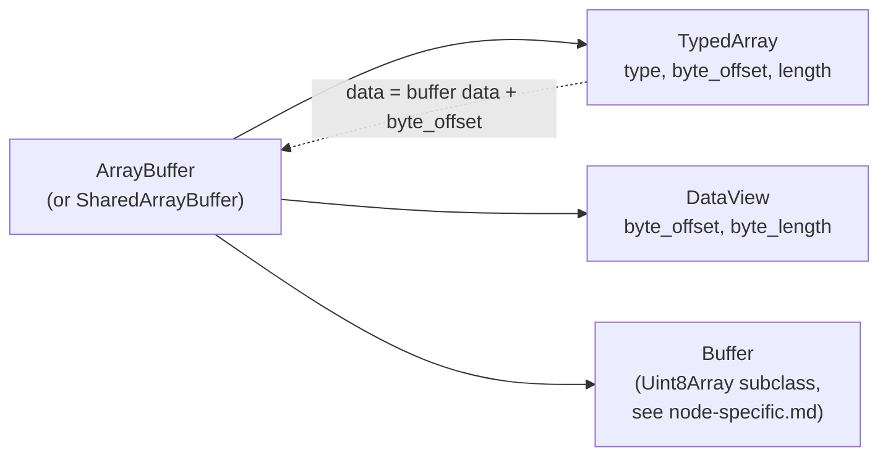

# ArrayBuffer, TypedArray, DataView, BigInt, Date, Promise

[Node-API reference](README.md) › Binary data and builtins

Implemented in `src/builtins.c`. Semantics follow Node.js 22.23 / V8 and are
checked against Node.js by `test/js/test_binary.js`.

| Group | Functions |
|---|---|
| ArrayBuffer | [`napi_create_arraybuffer`](#napi_create_arraybuffer), [`napi_create_external_arraybuffer`](#napi_create_external_arraybuffer), [`napi_is_arraybuffer`](#napi_is_arraybuffer), [`napi_get_arraybuffer_info`](#napi_get_arraybuffer_info), [`napi_detach_arraybuffer`](#napi_detach_arraybuffer), [`napi_is_detached_arraybuffer`](#napi_is_detached_arraybuffer) |
| TypedArray | [`napi_create_typedarray`](#napi_create_typedarray), [`napi_is_typedarray`](#napi_is_typedarray), [`napi_get_typedarray_info`](#napi_get_typedarray_info) |
| DataView | [`napi_create_dataview`](#napi_create_dataview), [`napi_is_dataview`](#napi_is_dataview), [`napi_get_dataview_info`](#napi_get_dataview_info) |
| BigInt | [`napi_create_bigint_int64`](#napi_create_bigint_int64), [`napi_create_bigint_uint64`](#napi_create_bigint_uint64), [`napi_create_bigint_words`](#napi_create_bigint_words), [`napi_get_value_bigint_int64`](#napi_get_value_bigint_int64), [`napi_get_value_bigint_uint64`](#napi_get_value_bigint_uint64), [`napi_get_value_bigint_words`](#napi_get_value_bigint_words) |
| Date | [`napi_create_date`](#napi_create_date), [`napi_is_date`](#napi_is_date), [`napi_get_date_value`](#napi_get_date_value) |
| Promise | [`napi_create_promise`](#napi_create_promise), [`napi_resolve_deferred`](#napi_resolve_deferred), [`napi_reject_deferred`](#napi_reject_deferred), [`napi_is_promise`](#napi_is_promise) |

## Implementation notes

- **Type checks use class IDs.** QuickJS does not export its class ID enum, so
  the IDs of `ArrayBuffer`, `SharedArrayBuffer`, `DataView`, `Date` and the
  typed arrays are found at startup by probing one instance of each. A check
  such as `napi_is_date` is therefore exact: an object whose prototype is
  `Date.prototype` is not a Date, and a Date from another realm is one.
- **Accessors are captured.** The `DataView` and `%TypedArray%` getters,
  `Date.prototype.getTime` and the `ArrayBuffer` / `DataView` constructors are
  captured before any user code runs: patching the globals has no effect.
- **Pointers into buffers stay valid while the buffer is alive and not
  detached.** QuickJS never moves ArrayBuffer memory, but resizing a
  resizable ArrayBuffer may reallocate it: read `data` again after JavaScript
  ran.



---

## ArrayBuffer

### `napi_create_arraybuffer`

```c
napi_status napi_create_arraybuffer(napi_env env, size_t byte_length,
                                    void **data, napi_value *result);
```

Creates a **zero-filled** ArrayBuffer of `byte_length` bytes (through the
`ArrayBuffer` constructor, so QuickJS's size limits apply: too large a size
throws a `RangeError`, `napi_pending_exception`). `data` (optional) receives
a pointer to the contents, `NULL` for a zero-length buffer.

### `napi_create_external_arraybuffer`

```c
napi_status napi_create_external_arraybuffer(
    napi_env env, void *external_data, size_t byte_length,
    node_api_basic_finalize finalize_cb, void *finalize_hint,
    napi_value *result);
```

Creates an ArrayBuffer over memory owned by the addon. The memory is **used in
place**, never copied nor freed by QuickJS. When the ArrayBuffer is collected,
`finalize_cb(env, external_data, finalize_hint)` runs (queued, from the
event loop, as in Node.js), and the addon frees the memory there.

`external_data == NULL` creates a buffer that reads as **detached** (V8 has
no backing store for `NULL` data).

### `napi_is_arraybuffer`

```c
napi_status napi_is_arraybuffer(napi_env env, napi_value value, bool *result);
```

`true` for an `ArrayBuffer` (detached ones included). `false` for a
`SharedArrayBuffer`, as in V8.

### `napi_get_arraybuffer_info`

```c
napi_status napi_get_arraybuffer_info(napi_env env, napi_value arraybuffer,
                                      void **data, size_t *byte_length);
```

Stores the contents pointer and size; both outputs are optional. Accepts an
`ArrayBuffer` or, like Node.js 22.23, a `SharedArrayBuffer`
(`napi_invalid_arg` for anything else). An empty or detached buffer has
`data == NULL` and length 0. For a resizable buffer the current length is
reported.

### `napi_detach_arraybuffer`

```c
napi_status napi_detach_arraybuffer(napi_env env, napi_value arraybuffer);
```

Detaches an ArrayBuffer, as `structuredClone(ab, {transfer: [ab]})` would:
its length becomes 0 and every view on it reads as empty.
`napi_arraybuffer_expected` for anything other than an `ArrayBuffer` (every
non-shared QuickJS ArrayBuffer is detachable). Detaching an external buffer
does not run its finalizer early; the finalizer still runs when the object is
collected.

### `napi_is_detached_arraybuffer`

```c
napi_status napi_is_detached_arraybuffer(napi_env env, napi_value value,
                                         bool *result);
```

`true` when `value` is an `ArrayBuffer` that has been detached, like V8's
`WasDetached()`; `false` for any other value.

## TypedArray

Supported types (`napi_typedarray_type`): `napi_int8_array`,
`napi_uint8_array`, `napi_uint8_clamped_array`, `napi_int16_array`,
`napi_uint16_array`, `napi_int32_array`, `napi_uint32_array`,
`napi_float32_array`, `napi_float64_array`, `napi_bigint64_array`,
`napi_biguint64_array` and `napi_float16_array`.

`napi_float16_array` is supported because QuickJS has `Float16Array`;
Node.js 22 returns `napi_invalid_arg` for it.

### `napi_create_typedarray`

```c
napi_status napi_create_typedarray(napi_env env, napi_typedarray_type type,
                                   size_t length, napi_value arraybuffer,
                                   size_t byte_offset, napi_value *result);
```

Creates a typed array of `length` elements over `arraybuffer` (an
`ArrayBuffer` or a `SharedArrayBuffer`), starting at `byte_offset`. Errors are
the same `RangeError`s as in Node.js, thrown with the function returning
`napi_generic_failure` and the exception pending:

| Condition | Code | Message |
|---|---|---|
| `byte_offset` not a multiple of the element size | `ERR_NAPI_INVALID_TYPEDARRAY_ALIGNMENT` | `start offset of Int32Array should be a multiple of 4` |
| `byte_offset + length * size` beyond the buffer | `ERR_NAPI_INVALID_TYPEDARRAY_LENGTH` | `Invalid typed array length` |

An unknown `type` or a non-buffer `arraybuffer` gives `napi_invalid_arg`.

### `napi_is_typedarray`

```c
napi_status napi_is_typedarray(napi_env env, napi_value value, bool *result);
```

`true` for an instance of any of the 12 typed array types, Buffers included.
`false` for a DataView.

### `napi_get_typedarray_info`

```c
napi_status napi_get_typedarray_info(napi_env env, napi_value typedarray,
                                     napi_typedarray_type *type,
                                     size_t *length, void **data,
                                     napi_value *arraybuffer,
                                     size_t *byte_offset);
```

Stores, for every non-`NULL` output: the element type, the length **in
elements**, a pointer to the first element (buffer data + offset), the
underlying ArrayBuffer and the byte offset. `napi_invalid_arg` when
`typedarray` is not a typed array.

- A view whose buffer is detached, or that is out of bounds after its
  resizable buffer shrank, reports length 0.
- A length-tracking view (created without a length on a resizable buffer)
  reports its current length.
- For an out-of-bounds, non-detached view the byte offset is reported as 0;
  V8 reports the stored offset, which QuickJS does not expose.

## DataView

### `napi_create_dataview`

```c
napi_status napi_create_dataview(napi_env env, size_t length,
                                 napi_value arraybuffer, size_t byte_offset,
                                 napi_value *result);
```

Creates a DataView of `length` bytes over an `ArrayBuffer`, starting at
`byte_offset` (`napi_invalid_arg` for anything other than an ArrayBuffer).
When the range exceeds the buffer, throws a `RangeError` with code
`ERR_NAPI_INVALID_DATAVIEW_ARGS` ("byte_offset + byte_length should be less
than or equal to the size in bytes of the array passed in") and returns
`napi_pending_exception`, as in Node.js.

### `napi_is_dataview`

```c
napi_status napi_is_dataview(napi_env env, napi_value value, bool *result);
```

`true` for a DataView.

### `napi_get_dataview_info`

```c
napi_status napi_get_dataview_info(napi_env env, napi_value dataview,
                                   size_t *bytelength, void **data,
                                   napi_value *arraybuffer,
                                   size_t *byte_offset);
```

Stores, for every non-`NULL` output: the length in bytes, a pointer to the
first byte, the underlying ArrayBuffer and the byte offset. On a detached
buffer, length and offset are 0, as V8 reports. `napi_invalid_arg` when
`dataview` is not a DataView.

## BigInt

QuickJS limits a BigInt to **2^20 bits** (16384 64-bit words); V8 allows 2^30.

### `napi_create_bigint_int64`

```c
napi_status napi_create_bigint_int64(napi_env env, int64_t value,
                                     napi_value *result);
```

Creates a BigInt from a signed 64-bit integer.

### `napi_create_bigint_uint64`

```c
napi_status napi_create_bigint_uint64(napi_env env, uint64_t value,
                                      napi_value *result);
```

Creates a BigInt from an unsigned 64-bit integer.

### `napi_create_bigint_words`

```c
napi_status napi_create_bigint_words(napi_env env, int sign_bit,
                                     size_t word_count, const uint64_t *words,
                                     napi_value *result);
```

Creates a BigInt from its magnitude as little-endian 64-bit words (`words[0]`
is the least significant) and a sign (`sign_bit != 0` for negative). Zero
words, or words that are all zero, give `0n` whatever the sign.

- `word_count > INT_MAX`: `napi_invalid_arg`.
- `word_count` above 16384: `RangeError: Maximum BigInt size exceeded`, with
  `napi_pending_exception`, checked before `words` is read (V8 throws the
  same error past its own limit).
- The conversion goes through a hexadecimal string: O(n) in the number of
  words.

### `napi_get_value_bigint_int64`

```c
napi_status napi_get_value_bigint_int64(napi_env env, napi_value value,
                                        int64_t *result, bool *lossless);
```

Stores the BigInt modulo 2^64 as a signed integer (two's complement), and
`*lossless = true` when that is exactly the value. Both outputs are required.
`napi_bigint_expected` when `value` is not a BigInt.

### `napi_get_value_bigint_uint64`

```c
napi_status napi_get_value_bigint_uint64(napi_env env, napi_value value,
                                         uint64_t *result, bool *lossless);
```

Same, as an unsigned integer (`-1n` gives `UINT64_MAX`, not lossless).

### `napi_get_value_bigint_words`

```c
napi_status napi_get_value_bigint_words(napi_env env, napi_value value,
                                        int *sign_bit, size_t *word_count,
                                        uint64_t *words);
```

Reads a BigInt as sign and magnitude words, like V8's
`BigInt::ToWordsArray`:

- **Count only:** with `sign_bit` and `words` both `NULL`, stores in
  `*word_count` the number of words the value needs.
- **Read:** `*word_count` is the capacity of `words` on input. The low words
  that fit are written; on output `*word_count` is the number of words the
  value needs (which may be more than were written). `*sign_bit` is 1 for a
  negative value.
- `0n` has no words and sign 0.

```c
size_t n;
napi_get_value_bigint_words(env, value, NULL, &n, NULL);
uint64_t *w = malloc(n * sizeof *w);
int sign;
napi_get_value_bigint_words(env, value, &sign, &n, w);
```

## Date

### `napi_create_date`

```c
napi_status napi_create_date(napi_env env, double time, napi_value *result);
```

Creates a Date from milliseconds since the epoch. `TimeClip` applies: values
beyond ±8.64e15 or non-finite give an invalid date (`NaN` time), as in V8.

### `napi_is_date`

```c
napi_status napi_is_date(napi_env env, napi_value value, bool *is_date);
```

`true` for a Date object.

### `napi_get_date_value`

```c
napi_status napi_get_date_value(napi_env env, napi_value value,
                                double *result);
```

Stores the time value in milliseconds (`NaN` for an invalid date), using the
`Date.prototype.getTime` captured at startup. `napi_date_expected` when
`value` is not a Date.

## Promise

A `napi_deferred` is the pair of resolving functions of a new promise. It is
**released by the first resolve or reject**; deferreds never concluded are
freed at teardown.

```c
napi_deferred deferred;
napi_value promise;
napi_create_promise(env, &deferred, &promise);
/* return `promise` to JavaScript; later, e.g. in an async work complete: */
napi_resolve_deferred(env, deferred, value);
```

### `napi_create_promise`

```c
napi_status napi_create_promise(napi_env env, napi_deferred *deferred,
                                napi_value *promise);
```

Creates a pending promise and its deferred. Both outputs are required.

### `napi_resolve_deferred`

```c
napi_status napi_resolve_deferred(napi_env env, napi_deferred deferred,
                                  napi_value resolution);
```

Resolves the promise with `resolution` (a thenable is followed, as with the
`resolve` function of `new Promise`) and frees the deferred. Reactions run at
the next microtask checkpoint, not synchronously.

### `napi_reject_deferred`

```c
napi_status napi_reject_deferred(napi_env env, napi_deferred deferred,
                                 napi_value rejection);
```

Rejects the promise with `rejection` and frees the deferred. A rejection
nobody handles is reported by the host as an unhandled rejection.

### `napi_is_promise`

```c
napi_status napi_is_promise(napi_env env, napi_value value, bool *is_promise);
```

`true` for a native Promise object (not for other thenables).
