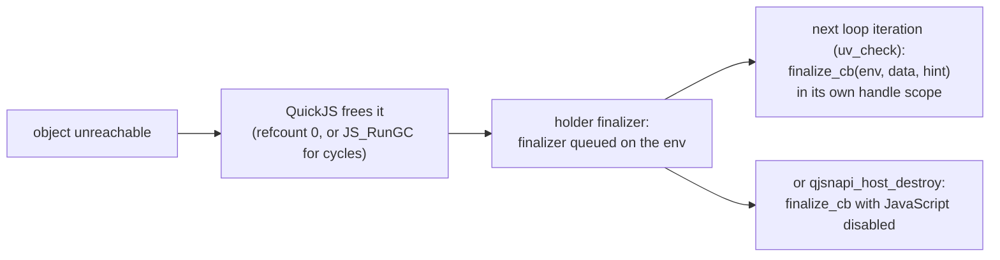

# References, externals, wrapping and finalizers

[Node-API reference](README.md) › Lifetime

Implemented in `src/lifetime.c`. This is where QuickJS (reference counting)
and V8 (tracing GC) differ most; the mechanism that bridges them, holders in
a `WeakMap` and the kept-objects list, is described in
[architecture.md](../architecture.md#object-lifetime).

| Group | Functions |
|---|---|
| References | [`napi_create_reference`](#napi_create_reference), [`napi_delete_reference`](#napi_delete_reference), [`napi_reference_ref`](#napi_reference_ref), [`napi_reference_unref`](#napi_reference_unref), [`napi_get_reference_value`](#napi_get_reference_value) |
| Wrapping | [`napi_wrap`](#napi_wrap), [`napi_unwrap`](#napi_unwrap), [`napi_remove_wrap`](#napi_remove_wrap) |
| Finalizers | [`napi_add_finalizer`](#napi_add_finalizer) |
| Externals | [`napi_create_external`](#napi_create_external), [`napi_get_value_external`](#napi_get_value_external) |
| Type tags | [`napi_type_tag_object`](#napi_type_tag_object), [`napi_check_object_type_tag`](#napi_check_object_type_tag) |
| Instance data | [`napi_set_instance_data`](#napi_set_instance_data), [`napi_get_instance_data`](#napi_get_instance_data) |
| Memory accounting | [`napi_adjust_external_memory`](#napi_adjust_external_memory) |

## When finalizers run

Every finalizer in this file (`napi_wrap`, `napi_add_finalizer`,
`napi_create_external`, instance data) runs **after** its object is
collected, never synchronously and never inside the garbage collector:



- A finalizer may call any Node-API function; JavaScript can run unless the
  env is tearing down (`napi_cannot_run_js`, or `napi_pending_exception` for
  modules built for Node-API < 10).
- An exception left pending by a finalizer is reported as uncaught.
- Finalizers of objects still alive at teardown run during
  `qjsnapi_host_destroy`: those with a finalizer first, newest first, then
  plain references.
- In the executable, `process.exit()` skips them, as in Node.js.

Because QuickJS frees objects as soon as their last reference goes away,
finalizers usually run **earlier** than in Node.js (at the next loop
iteration instead of the next major GC). Objects in reference cycles are
collected by the cycle collector (`JS_RunGC`, or `gc()` in the executable).

---

## References

A `napi_ref` keeps a value reachable across calls. It has a count: above 0
the reference is **strong**; at 0 it is **weak** for objects, functions and
non-registered symbols (the value can be collected, and the reference then
reads as empty), and released for any other value.

### `napi_create_reference`

```c
napi_status napi_create_reference(napi_env env, napi_value value,
                                  uint32_t initial_refcount, napi_ref *result);
```

Creates a reference with the given count.

- Modules built for **Node-API ≥ 10** may reference any value. Older modules
  may only reference objects, functions and symbols (`napi_invalid_arg`
  otherwise), as in Node.js.
- With `initial_refcount == 0` and an object target, the reference is weak
  from the start, but the object is kept alive until the end of the current
  macrotask (*kept objects*), as V8 keeps it until the next GC.
- A reference to a registered symbol (`Symbol.for`) is always strong; such
  symbols are never collected anyway.

The addon owns the reference and must delete it with
`napi_delete_reference`. References never deleted are freed at teardown.

### `napi_delete_reference`

```c
napi_status napi_delete_reference(node_api_basic_env env, napi_ref ref);
```

Deletes the reference and releases its value (if still held). Must be called
exactly once per reference created by `napi_create_reference`, and by
`napi_wrap` / `napi_add_finalizer` when they returned one (see there). Can be
called from a finalizer.

### `napi_reference_ref`

```c
napi_status napi_reference_ref(napi_env env, napi_ref ref, uint32_t *result);
```

Increments the count and stores the new value in `result` (optional). Going
from 0 to 1 makes a weak reference strong again, if its target is still
alive.

### `napi_reference_unref`

```c
napi_status napi_reference_unref(napi_env env, napi_ref ref,
                                 uint32_t *result);
```

Decrements the count and stores the new value in `result` (optional).
Reaching 0 makes the reference weak (or empty for primitives).
`napi_generic_failure` when the count is already 0.

### `napi_get_reference_value`

```c
napi_status napi_get_reference_value(napi_env env, napi_ref ref,
                                     napi_value *result);
```

Stores the referenced value, or `NULL` when a weak reference's target has
been collected (or a primitive was released at count 0). Always check for
`NULL` when the count may be 0.

## Wrapping

Wrapping attaches a native pointer to a JavaScript object, typically the
`this` of a class constructor (see the
[`napi_define_class` example](functions.md#napi_define_class)). The pointer is
stored in the object's *holder*, not in a property, so **any object** can be
wrapped: frozen objects, proxies and functions included, and wrapping is
invisible to JavaScript.

### `napi_wrap`

```c
napi_status napi_wrap(napi_env env, napi_value js_object, void *native_object,
                      node_api_basic_finalize finalize_cb,
                      void *finalize_hint, napi_ref *result);
```

Associates `native_object` with `js_object` (which must be an object:
`napi_invalid_arg` otherwise). When the object is collected,
`finalize_cb(env, native_object, finalize_hint)` runs.

- Wrapping an object that is already wrapped returns `napi_invalid_arg`.
- `result` (optional) receives a weak reference (count 0) to the object. That
  reference is **owned by the addon**: delete it from the finalizer, so
  `finalize_cb` is then required. Without `result`, the library owns the
  internal reference.

### `napi_unwrap`

```c
napi_status napi_unwrap(napi_env env, napi_value js_object, void **result);
```

Stores the pointer given to `napi_wrap`. `napi_invalid_arg` when `js_object`
is not an object or is not wrapped: methods use this to validate `this`.

### `napi_remove_wrap`

```c
napi_status napi_remove_wrap(napi_env env, napi_value js_object,
                             void **result);
```

Removes the wrap and stores the pointer in `result` (optional). **The
finalizer will not run**: the addon now owns the native object. If `napi_wrap`
returned a reference, the addon must still delete it. The object can then be
wrapped again.

## Finalizers

### `napi_add_finalizer`

```c
napi_status napi_add_finalizer(napi_env env, napi_value js_object,
                               void *finalize_data,
                               node_api_basic_finalize finalize_cb,
                               void *finalize_hint, napi_ref *result);
```

Runs `finalize_cb(env, finalize_data, finalize_hint)` when `js_object` (an
object or a function) is collected. Unlike `napi_wrap`, an object may have
any number of finalizers, and nothing can be retrieved from it. `finalize_cb`
is required. `result` (optional) receives a weak reference owned by the addon,
to be deleted with `napi_delete_reference`; without it the library deletes the
reference after the finalizer runs.

A common use: free the `data` of a function created with
`napi_create_function`.

## Externals

### `napi_create_external`

```c
napi_status napi_create_external(napi_env env, void *data,
                                 node_api_basic_finalize finalize_cb,
                                 void *finalize_hint, napi_value *result);
```

Creates a JavaScript value that carries a native pointer, like a
`v8::External`. JavaScript sees an object with a `null` prototype that is not
extensible (`typeof` is `'object'`); [`napi_typeof`](values.md#napi_typeof)
reports `napi_external`. When it is collected,
`finalize_cb(env, data, finalize_hint)` runs (if given).

### `napi_get_value_external`

```c
napi_status napi_get_value_external(napi_env env, napi_value value,
                                    void **result);
```

Stores the pointer of an external. `napi_invalid_arg` for any other value.

## Type tags

A type tag is a 128-bit value (`napi_type_tag {uint64_t lower, upper}`)
attached to an object, so that an addon can check that an object it receives
really is one of its own before unwrapping it:

```c
static const napi_type_tag kDatabaseTag = {0x1edf75a38336451d, 0xa5ed9ce2e4c00c38};
/* when creating */
napi_type_tag_object(env, obj, &kDatabaseTag);
/* when receiving */
bool ok;
napi_check_object_type_tag(env, arg, &kDatabaseTag, &ok);
```

Like wraps, tags live in the object's holder (or inside the external), not in
a property.

### `napi_type_tag_object`

```c
napi_status napi_type_tag_object(napi_env env, napi_value value,
                                 const napi_type_tag *type_tag);
```

Tags an object or an external. An object can be tagged only once:
`napi_invalid_arg` if it already has a tag. `null` and `undefined` give
`napi_object_expected`.

### `napi_check_object_type_tag`

```c
napi_status napi_check_object_type_tag(napi_env env, napi_value value,
                                       const napi_type_tag *type_tag,
                                       bool *result);
```

`true` when `value` carries exactly `type_tag`; `false` when it has another
tag or none.

## Instance data

Per-env data, the replacement for global variables in addons that can be
loaded several times (each load has its own env).

### `napi_set_instance_data`

```c
napi_status napi_set_instance_data(node_api_basic_env env, void *data,
                                   napi_finalize finalize_cb,
                                   void *finalize_hint);
```

Stores `data` on the env. `finalize_cb(env, data, finalize_hint)` (optional)
runs at teardown. Setting new data **replaces** the previous data without
finalizing it, as in Node.js.

### `napi_get_instance_data`

```c
napi_status napi_get_instance_data(node_api_basic_env env, void **data);
```

Stores the data set by `napi_set_instance_data`, or `NULL`.

## Memory accounting

### `napi_adjust_external_memory`

```c
napi_status napi_adjust_external_memory(node_api_basic_env env,
                                        int64_t change_in_bytes,
                                        int64_t *adjusted_value);
```

Adds `change_in_bytes` (may be negative) to a per-host counter of native
memory kept alive by JavaScript objects, and stores the new total. V8 uses
this counter to schedule garbage collections; QuickJS has no such notion, so
the counter is only bookkeeping. It never goes below 0 and saturates at
`INT64_MAX`.
