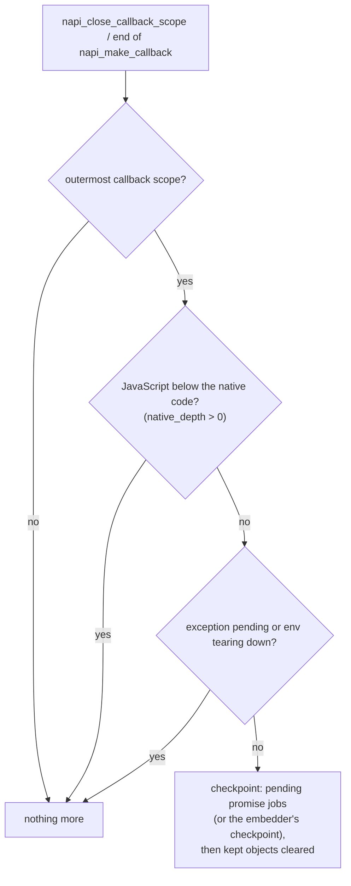

# Buffers, async context and callback scopes

[Node-API reference](README.md) › Node.js-specific APIs

The synchronous part of `node_api.h`. Implemented in `src/buffer.c` (with the
`Buffer` class of `src/buffer.js`) and `src/node_api.c`.

| Group | Functions |
|---|---|
| Buffers | [`napi_create_buffer`](#napi_create_buffer), [`napi_create_buffer_copy`](#napi_create_buffer_copy), [`napi_create_external_buffer`](#napi_create_external_buffer), [`node_api_create_buffer_from_arraybuffer`](#node_api_create_buffer_from_arraybuffer), [`napi_is_buffer`](#napi_is_buffer), [`napi_get_buffer_info`](#napi_get_buffer_info) |
| Async context | [`napi_async_init`](#napi_async_init), [`napi_async_destroy`](#napi_async_destroy), [`napi_make_callback`](#napi_make_callback) |
| Callback scopes | [`napi_open_callback_scope`](#napi_open_callback_scope), [`napi_close_callback_scope`](#napi_close_callback_scope) |
| Uncaught exceptions | [`napi_fatal_exception`](#napi_fatal_exception) |

---

## Buffers

Buffers are instances of a **minimal Node.js `Buffer`** embedded in the
library (`src/buffer.js`). As in Node.js, a buffer is a `FastBuffer`, a
`Uint8Array` subclass whose prototype is `Buffer.prototype`, so typed-array
APIs work on it too. The class provides:

| | |
|---|---|
| Static | `Buffer.from`, `alloc`, `allocUnsafe`, `allocUnsafeSlow`, `isBuffer`, `isEncoding`, `byteLength`, `concat`, `compare`, `poolSize` |
| Prototype | `toString`, `toLocaleString`, `write`, `equals`, `compare`, `copy`, `fill`, `slice`, `subarray`, `toJSON`, `indexOf`, `includes` |
| Encodings | `utf8`, `utf16le` (`ucs2`), `latin1` (`binary`), `ascii`, `hex`, `base64`, `base64url` |

The library installs no global. The embedder gets the class with
[`qjsnapi_host_get_buffer`](../embedding.md#qjsnapi_host_get_buffer); the
`quickjs-napi` executable exposes it as `globalThis.Buffer` and
`require('buffer').Buffer`.

### `napi_create_buffer`

```c
napi_status napi_create_buffer(napi_env env, size_t length, void **data,
                               napi_value *result);
```

Creates a Buffer of `length` bytes and stores a pointer to its contents in
`data` (optional; `NULL` when `length` is 0). The memory is **zero-filled**;
Node.js leaves it uninitialized, so addons cannot rely on either.

### `napi_create_buffer_copy`

```c
napi_status napi_create_buffer_copy(napi_env env, size_t length,
                                    const void *data, void **result_data,
                                    napi_value *result);
```

Creates a Buffer holding a copy of `length` bytes from `data`, and stores a
pointer to the new contents in `result_data` (optional).

### `napi_create_external_buffer`

```c
napi_status napi_create_external_buffer(napi_env env, size_t length,
                                        void *data,
                                        node_api_basic_finalize finalize_cb,
                                        void *finalize_hint,
                                        napi_value *result);
```

Creates a Buffer over memory owned by the addon, **used in place**. When the
underlying ArrayBuffer is collected, `finalize_cb(env, data, finalize_hint)`
runs (queued, from the event loop, as Node.js defers it). External buffers are
always allowed: `napi_no_external_buffers_allowed` is never returned.

### `node_api_create_buffer_from_arraybuffer`

```c
napi_status node_api_create_buffer_from_arraybuffer(napi_env env,
                                                    napi_value arraybuffer,
                                                    size_t byte_offset,
                                                    size_t byte_length,
                                                    napi_value *result);
```

Creates a Buffer that **shares** the memory of an `ArrayBuffer` (no copy),
over `byte_length` bytes from `byte_offset`. `napi_invalid_arg` when
`arraybuffer` is not an `ArrayBuffer`. When the range does not fit, throws a
`RangeError` with code `ERR_OUT_OF_RANGE` ("The byte offset + length is out of
range") and returns `napi_pending_exception`; `*result` is not set. Node.js
returns `napi_ok` in that case, with the same exception pending.

### `napi_is_buffer`

```c
napi_status napi_is_buffer(napi_env env, napi_value value, bool *result);
```

`true` for a Buffer and, as in Node.js 22 (`node::Buffer::HasInstance`), for
**any ArrayBufferView**: every typed array and DataView.

### `napi_get_buffer_info`

```c
napi_status napi_get_buffer_info(napi_env env, napi_value value, void **data,
                                 size_t *length);
```

Stores the contents pointer and the length in bytes of a Buffer or any other
ArrayBufferView (both outputs optional). `napi_invalid_arg` for anything else.

## Async context

Node.js associates native callbacks with `async_hooks` resources, so that
`AsyncLocalStorage` and async stack traces follow them. **quickjs-napi has no
`async_hooks`**: an async context only records that it exists, and the
resource and its name are validated but not used. The functions are provided
so that addons using them load and behave correctly.

### `napi_async_init`

```c
napi_status napi_async_init(napi_env env, napi_value async_resource,
                            napi_value async_resource_name,
                            napi_async_context *result);
```

Creates an async context. `async_resource` is optional; `null` or `undefined`
give `napi_object_expected` (without a pending exception, as in Node.js).
`async_resource_name` is required. Contexts never destroyed are freed at
teardown.

### `napi_async_destroy`

```c
napi_status napi_async_destroy(napi_env env, napi_async_context async_context);
```

Frees an async context.

### `napi_make_callback`

```c
napi_status napi_make_callback(napi_env env, napi_async_context async_context,
                               napi_value recv, napi_value func, size_t argc,
                               const napi_value *argv, napi_value *result);
```

Calls `func` with `this = recv` the way Node.js calls JavaScript from native
code that was not itself called by JavaScript (an I/O completion, a timer of
the addon). Compared to `napi_call_function`:

- the call runs inside a **callback scope**: when it is the outermost one and
  no JavaScript is on the stack, the host's checkpoint (microtasks,
  `process.nextTick`) runs after `func` returns, as Node's
  `InternalCallbackScope` does;
- `recv` is converted with `ToObject` (`null` / `undefined` give
  `napi_object_expected` with a `TypeError` pending);
- `func` must be a function (`napi_function_expected`);
- `async_context` may be `NULL`; at most 65535 arguments.

`result` is optional.

## Callback scopes

### `napi_open_callback_scope`

```c
napi_status napi_open_callback_scope(napi_env env, napi_value resource_object,
                                     napi_async_context context,
                                     napi_callback_scope *result);
```

Opens a callback scope, for native code that calls into JavaScript several
times (with `napi_call_function`) and wants a single checkpoint at the end.
`context` is required; `resource_object` is ignored, as in Node.js.

### `napi_close_callback_scope`

```c
napi_status napi_close_callback_scope(napi_env env,
                                      napi_callback_scope scope);
```

Closes the scope. When it is the outermost callback scope of the host, no
JavaScript is below the current native code, and no exception is pending,
the checkpoint runs here. `napi_callback_scope_mismatch` when no callback
scope is open.



Inside a Node-API callback called by JavaScript (the usual case) the caller's
own frame is still on the stack, so nothing runs early, exactly as in Node.js.

## Uncaught exceptions

### `napi_fatal_exception`

```c
napi_status napi_fatal_exception(napi_env env, napi_value err);
```

Reports `err` as an uncaught exception **synchronously**: the host's uncaught
handler runs before the function returns. In the executable that means
`process.on('uncaughtException')` listeners, or printing the error and
exiting with code 1 when there are none. Despite its name, the process does
not necessarily end.
