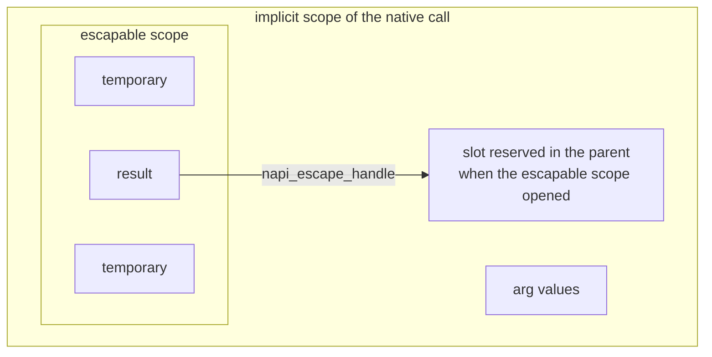

# Handle scopes

[Node-API reference](README.md) › Handle scopes

Implemented in `src/scope.c`. The arena behind them is described in
[architecture.md](../architecture.md#values-and-handle-scopes).

| Function | Purpose |
|---|---|
| [`napi_open_handle_scope`](#napi_open_handle_scope) | start a scope for temporary values |
| [`napi_close_handle_scope`](#napi_close_handle_scope) | release every value created since it opened |
| [`napi_open_escapable_handle_scope`](#napi_open_escapable_handle_scope) | same, with room for one value that survives |
| [`napi_close_escapable_handle_scope`](#napi_close_escapable_handle_scope) | close it |
| [`napi_escape_handle`](#napi_escape_handle) | promote one value to the parent scope |

## When to use them

Every `napi_value` keeps its JavaScript value alive until the scope it was
created in is closed. Each native entry point (a function call, module init, a
finalizer, a loop callback) already runs in an implicit scope, closed when it
returns. Explicit scopes are needed only when one call creates **many
temporary values**, typically in a loop:

```c
for (uint32_t i = 0; i < n; i++) {
  napi_handle_scope scope;
  napi_open_handle_scope(env, &scope);
  napi_value item;
  napi_get_element(env, array, i, &item);   /* released at close */
  /* ... */
  napi_close_handle_scope(env, scope);
}
```

Without the inner scope, a loop over a million elements keeps a million
values alive until the callback returns.



Rules:

- Scopes are **strictly nested**: close them in reverse order of opening.
  Closing a scope that is not the innermost one returns
  `napi_handle_scope_mismatch` and closes nothing.
- A `napi_value` from a closed scope must not be used.
- Close every scope you open before returning. A scope left open by a
  function called from JavaScript is closed automatically with the call's
  implicit scope (Debug builds print a warning). A scope left open by a
  callback entered from the event loop (async work `complete`, a thread-safe
  function's `call_js_cb`) or by a finalizer is a **fatal error** ("a callback
  left a handle scope open", "a finalizer left a handle scope open"), as in
  Node.js.
- Opening a scope does not allocate in the steady state: scope records are
  recycled.

---

### `napi_open_handle_scope`

```c
napi_status napi_open_handle_scope(napi_env env, napi_handle_scope *result);
```

Opens a scope nested in the current one. Values created afterwards belong to
it.

### `napi_close_handle_scope`

```c
napi_status napi_close_handle_scope(napi_env env, napi_handle_scope scope);
```

Closes `scope`, releasing every value created since it was opened.

- `napi_handle_scope_mismatch`: no user scope is open, or `scope` is not the
  innermost one.
- `napi_invalid_arg`: `scope` is not a handle scope (for example an escapable
  scope, which needs `napi_close_escapable_handle_scope`).

### `napi_open_escapable_handle_scope`

```c
napi_status napi_open_escapable_handle_scope(
    napi_env env, napi_escapable_handle_scope *result);
```

Opens a scope from which one value can be escaped. A slot is reserved in the
**parent** scope before the new scope starts, so the escaped value belongs to
the parent.

### `napi_close_escapable_handle_scope`

```c
napi_status napi_close_escapable_handle_scope(
    napi_env env, napi_escapable_handle_scope scope);
```

Closes an escapable scope, with the same rules as `napi_close_handle_scope`.

### `napi_escape_handle`

```c
napi_status napi_escape_handle(napi_env env, napi_escapable_handle_scope scope,
                               napi_value escapee, napi_value *result);
```

Copies `escapee` into the slot reserved in the parent scope and stores in
`result` a `napi_value` that stays valid after `scope` is closed. Allowed once
per scope: a second call returns `napi_escape_called_twice`.

```c
static napi_value make_point(napi_env env, double x, double y) {
  napi_escapable_handle_scope scope;
  napi_open_escapable_handle_scope(env, &scope);
  napi_value obj, vx, vy, escaped;
  napi_create_object(env, &obj);
  napi_create_double(env, x, &vx);
  napi_create_double(env, y, &vy);
  napi_set_named_property(env, obj, "x", vx);
  napi_set_named_property(env, obj, "y", vy);
  napi_escape_handle(env, scope, obj, &escaped);
  napi_close_escapable_handle_scope(env, scope); /* vx, vy released */
  return escaped;
}
```
