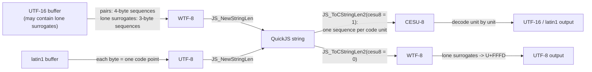

# Strings, property keys and symbols

[Node-API reference](README.md) › Strings

Implemented in `src/string.c`.

| Group | Functions |
|---|---|
| Creation | [`napi_create_string_latin1`](#napi_create_string_latin1), [`napi_create_string_utf8`](#napi_create_string_utf8), [`napi_create_string_utf16`](#napi_create_string_utf16) |
| External strings | [`node_api_create_external_string_latin1`](#node_api_create_external_string_latin1), [`node_api_create_external_string_utf16`](#node_api_create_external_string_utf16) |
| Property keys | [`node_api_create_property_key_latin1`](#node_api_create_property_key_latin1), [`node_api_create_property_key_utf8`](#node_api_create_property_key_utf8), [`node_api_create_property_key_utf16`](#node_api_create_property_key_utf16) |
| Extraction | [`napi_get_value_string_latin1`](#napi_get_value_string_latin1), [`napi_get_value_string_utf8`](#napi_get_value_string_utf8), [`napi_get_value_string_utf16`](#napi_get_value_string_utf16) |
| Symbols | [`napi_create_symbol`](#napi_create_symbol), [`node_api_symbol_for`](#node_api_symbol_for) |

## How strings are converted

JavaScript strings are sequences of UTF-16 code units. QuickJS has no public
UTF-16 API, but its UTF-8 entry points are lossless at the code-unit level,
and quickjs-napi relies on that:



- **Creation** is exact: a UTF-16 buffer with lone surrogates round-trips
  unchanged.
- **Extraction** follows V8 as used by Node.js: lengths are counted in code
  units for latin1 and UTF-16 and in bytes for UTF-8; UTF-8 output never ends
  with a partial character and replaces lone surrogates with U+FFFD; latin1
  output keeps the low byte of each code unit (V8 `WriteOneByte`).

### Length arguments

Creation functions take a `length` in code units (bytes for latin1 and
UTF-8, `char16_t` for UTF-16) or `NAPI_AUTO_LENGTH` for a NUL-terminated
string. `str` may be `NULL` only when `length` is `0`. A length above
`INT32_MAX` (other than `NAPI_AUTO_LENGTH`) returns `napi_invalid_arg`.

### Buffer arguments

The three `napi_get_value_string_*` functions share one protocol:

| `buf` | `bufsize` | Effect |
|---|---|---|
| `NULL` | ignored | `*result` = full length (code units, or UTF-8 bytes), without the terminator. `result` is then required. |
| not `NULL` | `0` | nothing is written; `*result` = `0` |
| not `NULL` | `n > 0` | at most `n - 1` units are copied, then a NUL terminator; `*result` (optional) = units copied |

The usual pattern is two calls:

```c
size_t len;
napi_get_value_string_utf8(env, value, NULL, 0, &len);
char *s = malloc(len + 1);
napi_get_value_string_utf8(env, value, s, len + 1, &len);
```

All extraction functions return `napi_string_expected` when `value` is not a
string primitive (`String` objects are not converted).

---

## Creation

### `napi_create_string_latin1`

```c
napi_status napi_create_string_latin1(napi_env env, const char *str,
                                      size_t length, napi_value *result);
```

Creates a string from ISO-8859-1 bytes: each byte becomes the code point of
the same value (0x00 to 0xFF).

### `napi_create_string_utf8`

```c
napi_status napi_create_string_utf8(napi_env env, const char *str,
                                    size_t length, napi_value *result);
```

Creates a string from UTF-8 bytes.

### `napi_create_string_utf16`

```c
napi_status napi_create_string_utf16(napi_env env, const char16_t *str,
                                     size_t length, napi_value *result);
```

Creates a string from UTF-16 code units, lone surrogates included. With
`NAPI_AUTO_LENGTH` the buffer ends at the first `0` unit.

## External strings

V8 can create a string that points to memory owned by the addon. QuickJS
cannot: its strings always own their content.

### `node_api_create_external_string_latin1`

```c
napi_status node_api_create_external_string_latin1(
    napi_env env, char *str, size_t length,
    node_api_basic_finalize finalize_callback, void *finalize_hint,
    napi_value *result, bool *copied);
```

Creates a string from latin1 bytes. The content is **always copied**:
`*copied` is set to `true` (when `copied` is not `NULL`) and
`finalize_callback(env, str, finalize_hint)` runs **before the function
returns**, so the addon may free `str` right away. This is exactly what
Node.js does when V8 is built with the pointer-compression sandbox, so addons
already handle it.

### `node_api_create_external_string_utf16`

```c
napi_status node_api_create_external_string_utf16(
    napi_env env, char16_t *str, size_t length,
    node_api_basic_finalize finalize_callback, void *finalize_hint,
    napi_value *result, bool *copied);
```

Same, from UTF-16 code units.

## Property keys

V8 internalizes these strings so that property lookups with them are faster.
QuickJS turns any string used as a property key into an *atom*, so these
functions create **ordinary strings**; using them as keys is as fast as with
any other string.

### `node_api_create_property_key_latin1`

```c
napi_status node_api_create_property_key_latin1(napi_env env, const char *str,
                                                size_t length,
                                                napi_value *result);
```

Same as `napi_create_string_latin1`.

### `node_api_create_property_key_utf8`

```c
napi_status node_api_create_property_key_utf8(napi_env env, const char *str,
                                              size_t length,
                                              napi_value *result);
```

Same as `napi_create_string_utf8`.

### `node_api_create_property_key_utf16`

```c
napi_status node_api_create_property_key_utf16(napi_env env,
                                               const char16_t *str,
                                               size_t length,
                                               napi_value *result);
```

Same as `napi_create_string_utf16`.

## Extraction

### `napi_get_value_string_latin1`

```c
napi_status napi_get_value_string_latin1(napi_env env, napi_value value,
                                         char *buf, size_t bufsize,
                                         size_t *result);
```

Copies the string as one byte per UTF-16 code unit, keeping the **low byte**
of each unit (characters above U+00FF are therefore mangled, as in Node.js).
Lengths are in code units.

### `napi_get_value_string_utf8`

```c
napi_status napi_get_value_string_utf8(napi_env env, napi_value value,
                                       char *buf, size_t bufsize,
                                       size_t *result);
```

Copies the string as UTF-8. Lengths are in bytes. A character is never split:
if the next character does not fit in the remaining space, copying stops
before it. Lone surrogates become U+FFFD (`EF BF BD`).

### `napi_get_value_string_utf16`

```c
napi_status napi_get_value_string_utf16(napi_env env, napi_value value,
                                        char16_t *buf, size_t bufsize,
                                        size_t *result);
```

Copies the UTF-16 code units exactly (lone surrogates included). Lengths are
in code units; a buffer that is too short may end between the two halves of
a surrogate pair.

## Symbols

### `napi_create_symbol`

```c
napi_status napi_create_symbol(napi_env env, napi_value description,
                               napi_value *result);
```

Creates a new unique symbol, like `Symbol(description)`. `description` may be
`NULL` (no description) or a string; anything else gives
`napi_string_expected`. Uses the `Symbol` function captured at startup.

### `node_api_symbol_for`

```c
napi_status node_api_symbol_for(napi_env env, const char *utf8description,
                                size_t length, napi_value *result);
```

`Symbol.for(description)`: returns the symbol registered under that key in
the global symbol registry, creating it if needed. The description is UTF-8
with the usual length rules.

Registered symbols are never collected; a `napi_ref` to one always stays
strong (see [lifetime.md](lifetime.md#napi_create_reference)).
